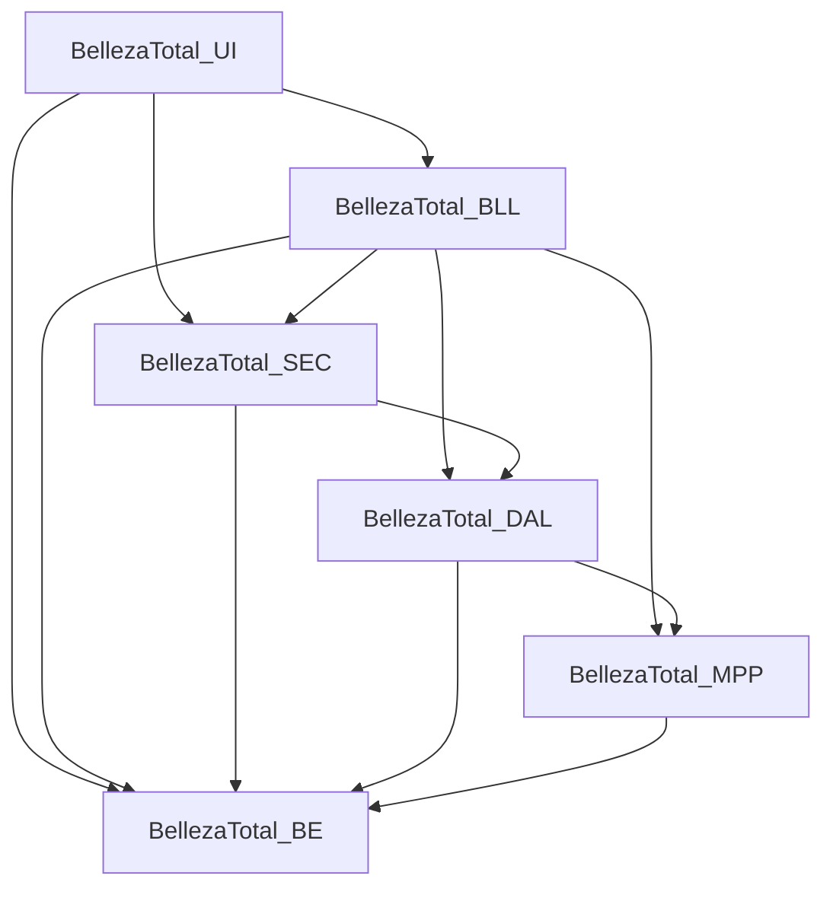

# BellezaTotal

Aplicación de escritorio (Windows Forms, C# / .NET Framework 4.7.2) para gestionar un centro de estética: turnos, clientes, servicios y planes, profesionales, cabinas, insumos y proveedores, con control de acceso por permisos, bitácora de auditoría y soporte de dos idiomas (español / inglés).

> Proyecto personal de estudio. Los datos de conexión y de correo que figuran en este documento son de ejemplo.

## Funcionalidades

Seguridad y administración
- Inicio de sesión con bloqueo de la cuenta tras 3 intentos fallidos.
- Registro de usuarios (el usuario nuevo recibe la familia `FAM_INVITADO`).
- Permisos por **familias** (grupos anidables) y **patentes** (permisos individuales), asignables a usuarios.
- Gestión de usuarios y de familias de permisos.
- Bitácora de auditoría con filtros (fecha, usuario, severidad) y exportación a PDF.
- Copia de seguridad y restauración de la base de datos (`BACKUP DATABASE` / `RESTORE DATABASE`).
- Cambio de idioma (es / en) en tiempo de ejecución.

Negocio
- Gestión de turnos con validaciones (cliente, profesional, cabina y servicio obligatorios; servicio activo; profesional capacitado; cabina disponible).
- Sala de espera y registro de llegada de clientes.
- Gestión de clientes, con ficha técnica (alergias, afecciones y contraindicaciones).
- **Importación y exportación de clientes en XML.**
- Catálogo de servicios (tratamientos faciales, corporales, servicios estéticos) y planes estéticos compuestos por servicios.
- Gestión de profesionales (con especialidades), cabinas y bloqueos de cabina.
- Control de insumos y reposición, con envío del pedido por correo (SMTP).
- Gestión de proveedores, con validación de CUIT.
- Analíticas: servicios más solicitados y uso de cabinas, con gráficos.

## Arquitectura

Solución con 6 proyectos en capas:

| Proyecto | Responsabilidad |
|---|---|
| `BellezaTotal_UI` | Interfaz Windows Forms (formularios y controles de usuario). Proyecto de inicio. |
| `BellezaTotal_BLL` | Lógica de negocio y validaciones; correo, PDF, estadísticas, import/export XML, gestor de idiomas. |
| `BellezaTotal_SEC` | Seguridad: sesión, hash de contraseñas, permisos efectivos y bitácora. |
| `BellezaTotal_DAL` | Acceso a datos con ADO.NET (`System.Data.SqlClient`) y consultas SQL parametrizadas. |
| `BellezaTotal_MPP` (carpeta `BellezaTotal_MAPPER`) | Mappers: convierten filas de la base de datos en entidades; también serialización XML. |
| `BellezaTotal_BE` | Entidades de negocio y excepciones (`ExcepcionNegocio`). |

Dependencias entre proyectos (según los `.csproj`):



## Tecnologías utilizadas

- C# y .NET Framework 4.7.2
- Windows Forms (con `System.Windows.Forms.DataVisualization` para gráficos)
- SQL Server, acceso mediante ADO.NET (`System.Data.SqlClient`)
- MailKit / MimeKit 4.18.2 (envío de correo SMTP)
- QuestPDF 2026.9.1 (exportación a PDF, licencia Community configurada en el código)
- `XmlSerializer` (importación/exportación de clientes)
- SHA-256 (`System.Security.Cryptography`) para el hash de contraseñas

## Requisitos previos

- Windows.
- Visual Studio con la carga de trabajo de escritorio .NET y el targeting pack de .NET Framework 4.7.2. Versión exacta de Visual Studio: [completar].
- Una instancia de SQL Server accesible. Versión / edición utilizada: [completar].
- Acceso a NuGet para restaurar paquetes.

## Cómo ejecutarlo

1. **Clonar el repositorio**
   ```
   git clone https://github.com/lucaleonardii/BellezaTotal.git
   ```

2. **Crear la base de datos.** El script `ConsultaMain.sql` (raíz del repo) crea la base `BellezaTotal`, los esquemas `Seguridad` y `Negocio`, las tablas de seguridad (idiomas, leyendas, usuarios, familias, patentes, bitácora), los datos iniciales de permisos y un trigger que hace la bitácora de solo lectura.
   - **Pendiente:** este script **no** incluye las tablas del esquema `Negocio` (clientes, turnos, servicios, insumos, etc.), que la aplicación necesita. Script de esas tablas: [completar].

3. **Configurar la cadena de conexión** en `BellezaTotal_UI/App.config`. Valor de ejemplo (SQL Server local con autenticación de Windows):
   ```xml
   <connectionStrings>
     <add name="conexion"
          connectionString="Data Source=localhost;Initial Catalog=BellezaTotal;Integrated Security=True"
          providerName="System.Data.SqlClient" />
   </connectionStrings>
   ```

4. **Configurar el correo (opcional, solo para enviar pedidos de reposición).** Las credenciales no están en el repositorio: en `BellezaTotal_BLL/Clases/EmailBLL.cs` los campos `correoRemitente` y `contraseñaAplicacion` tienen el valor `placeholder`. Mecanismo recomendado para configurarlos sin subirlos al repo: [completar].

5. **Compilar y ejecutar.** Abrir `BellezaTotal.sln`, restaurar paquetes NuGet, dejar `BellezaTotal_UI` como proyecto de inicio y ejecutar.

6. **Usuario inicial.** El script incluye, comentado, un `INSERT` para un usuario `admin`. Ese `INSERT` no asigna familias ni permisos, y no encontré en el código otro paso que lo haga. Procedimiento para obtener un usuario con permisos completos: [completar].

## Estructura de carpetas

```
BellezaTotal/
├── BellezaTotal.sln
├── ConsultaMain.sql           # Script de base de datos (esquema Seguridad)
├── BellezaTotal_UI/           # Formularios y controles (WinForms)
├── BellezaTotal_BLL/
│   └── Clases/                # Lógica de negocio (+ subcarpetas Insumos y xml)
├── BellezaTotal_SEC/
│   └── Clases/                # Sesión, hash, permisos, bitácora
├── BellezaTotal_DAL/
│   ├── Clases/                # Acceso a datos
│   └── Interfaces/            # IABMC<T>
├── BellezaTotal_MAPPER/       # Proyecto BellezaTotal_MPP: mappers y XmlHelper
├── BellezaTotal_BE/           # Entidades por dominio (Agenda, Personas, Servicios, Familias, ...)
├── BellezaTotal/              # Proyecto WinForms adicional, no incluido en la solución
└── packages/                  # Paquetes NuGet (versionados en el repo)
```

## Capturas de pantalla

[agregar capturas]

## Autor

Luca Leonardi · [LinkedIn](https://www.linkedin.com/in/luca-leonardi-98314a213/)
Joaquina Marraco · [LinkedIn](https://www.linkedin.com/in/joaquina-marraco-2845a8212/)
